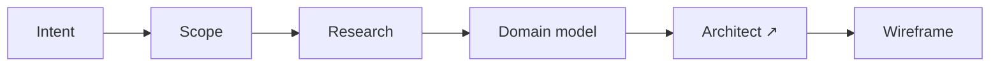
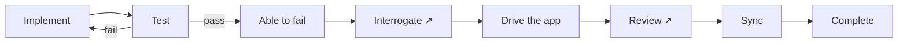

# claude-bts

**B**ulletproof **T**echnical **S**pecification — a spec-first workflow for Claude Code that settles the direction with you, lands in code early, and proves the change by runs.

[](https://github.com/imtemp-dev/claude-bts/actions/workflows/ci.yml)
[](https://github.com/imtemp-dev/claude-bts/releases)
[](LICENSE)
[](https://go.dev)

[For AI Agents](llms.txt)

## Why

You already do the right things — reminding AI of the architecture, asking for reviews, checking edge cases. But doing it by hand means some sessions are thorough and some are not, and once AI is deep in implementation it loses sight of what the whole change was for.

bts makes those habits the default:

- **Direction you confirmed** — intent and scope are confirmed by you before any design work; a build or blueprint recipe cannot leave discovery without that confirmation. The spec the code is built from (`final.md`, or a fix's `fix-spec.md`) is confirmed by you too, before any implementation.
- **Truth from runs** — the design lands as a skeleton that compiles and a test for each new invariant that fails first; implementation is done when those tests pass, and every finding an adversary reports must be reproduced by a run.
- **Isolated review** — verification and code review run in separate agent contexts that do not share the blind spots of the session that did the work.
- **State that survives** — findings, decisions and phase history persist across sessions and compactions.
- **Completion gates** — the Stop hook refuses a completion marker until the recipe's gates pass.

The core idea: **argue in prose only what code cannot settle; settle everything else by running it.**

## Install

```bash
# Homebrew (macOS / Linux)
brew install imtemp-dev/tap/claude-bts

# Or one-line install (latest release binary)
curl -fsSL https://raw.githubusercontent.com/imtemp-dev/claude-bts/main/install.sh | bash

# Or build from source (Go 1.26+); make install copies bts to ~/.local/bin, which must be on PATH
git clone https://github.com/imtemp-dev/claude-bts.git && cd claude-bts && make install
```

```bash
# Update the binary; a project's templates follow at its next session start with no
# active recipe, at the next `bts recipe create`, or now with `bts update`
brew upgrade claude-bts

# Uninstall (binary only — .bts/ and .claude/ stay in your project)
brew uninstall claude-bts
```

## Quick Start

```bash
cd your-project && bts init . && claude
```

`bts init` writes `.claude/` (skills, agents, rules, commands, and its hooks in `settings.local.json`), `.bts/`, `.mcp.json` and `.vscode/` snippets. In a repository you only visit, `bts init --exclude .` keeps all of it out of git through the repository's `info/exclude` and changes no tracked file.

Then inside Claude Code:

```bash
/bts-recipe-build add OAuth2 login                  # intent → scope → domain → skeleton → falsifiers → implement → prove → complete
/bts-recipe-fix login bcrypt hash comparison fails  # diagnose → fix-spec → reproduce → implement → test → prove → review
/bts-recipe-debug session drops after 5 minutes     # six perspectives → root cause → fix-spec → implement → prove → review
```

A small build (at most three scope items, no new integration, no migration) runs in **express** mode; bts offers it when you confirm such a scope.

## How It Works

The build recipe, from request to merged-ready code:

### 1. Agree on the destination



You confirm the intent, the scope and, before implementation, the spec. By default you review them on a **review page**: bts serves the change from your machine and opens it in your browser (or Orca's), drawn rather than retold (the spec as its parts and files, each invariant on the part that owns it with its test; a fix as the failing path today and after), you pin notes on it (typed or spoken) and send them in rounds, Claude answers and proposes edits, and you confirm a fingerprinted version. Implementation does not start until the spec is confirmed. A feature split into several recipes gets a page too: its items as a dependency graph with the contracts between them, confirmed as one version before any item starts. The page belongs to no claude.ai account, so switching accounts or sessions mid-review keeps it and its rounds, and the hooks refuse to publish it as an artifact. Set `review.surface: artifact` to publish it on claude.ai instead, or `ask` to answer in the chat; a run no one sits at (headless, or a Multica worker) asks in the chat too.

The domain model names each invariant and the one place that enforces it. The architect step has two independent runners propose decompositions, debates them, and has an adjudicator pick one. The wireframe lays out the structure and the files the change touches. **↗ = separate agent context.**

### 2. Land in code early


The design is stated as code: a skeleton that compiles, with bodies that fail loudly, and one test per invariant the change introduces that fails now for that invariant's own reason; an invariant the change only carries keeps its existing, passing test. Questions that running something would answer are answered by a throwaway probe, not argued. One review of the build spec (`final.md`) reads what only judgment can see. The Stop hook lets the recipe finalize only when the skeleton builds, every introduced invariant's falsifier is recorded red and every carried one green, the scope is covered and the review is clean.

### 3. Implement and prove



Implementation fills the skeleton until the falsifiers pass. Then the change is proved by runs: each falsifier must still fail with its guard broken; adversaries try to break the change, each in a private copy of the project, and only what a rerun reproduces survives; the user journeys the change touches are driven through the real app with the project's `verify-<app>` skill. Code review runs from three perspectives in separate contexts, and sync records every deviation between the spec and the code.

### Express mode

For a small change, express keeps what makes a build trustworthy — confirmed intent, scope and spec, invariants with one owner each, a skeleton that compiles, a falsifier per invariant, the prove stage, one code review, sync — and drops the architect's runners and debate, the review round on `final.md` and the second adversary. Research covers only the questions that decide an invariant's owner, other open questions and their probes wait for implementation, and `final.md` keeps only what ships, the invariants, scope coverage and the open questions. A recipe becomes express only before its architect step, and moves to the full recipe (one way) when it outgrows express.

### Blueprint: when the design must be argued first

`/bts-recipe-blueprint` sets direction the same way (intent, scope, research, domain model, architect, wireframe), then converges a prose spec before any code: draft → verify and audit ↗ → assess → improve, defend or debate → verify again. The loop ends at two consecutive clean passes over an unchanged spec. At the round cap (`verify.max_rounds`) the open findings move to `## Known Uncertainties` and implementation settles them; when rounds stop making progress (`verify.max_iterations`), the loop stops and asks you. The recipe then goes through the same implement and prove stages as the build recipe, without the falsifier steps.

## Recipes

| Recipe | Lifecycle | Output |
|--------|-----------|--------|
| `/bts-recipe-build` | intent → scope → research → domain → architect → wireframe → skeleton → falsify → one review → implement → prove → review → sync; `express` drops the architect's runners and the review round | build spec + skeleton → code → tests |
| `/bts-recipe-blueprint` | intent → scope → research → domain → architect → wireframe → draft ⇄ verify and audit → finalize → implement → prove → review → sync | Level 3 spec → code → tests |
| `/bts-recipe-fix` | diagnose → fix-spec (root cause, adversarial validation, reproduction run, expert review) → implement → test → prove → review | fix spec → code → tests |
| `/bts-recipe-debug` | six-perspective analysis → cross-reference → fix-spec → implement → prove → review → sync | root cause → fix |
| `/bts-recipe-design` | research → draft ⇄ verify → finalize | Level 2 design doc |
| `/bts-recipe-analyze` | research → draft ⇄ verify → finalize | Level 1 analysis doc |

## Features

A change too large for one recipe becomes a **feature**: a plan of items you confirm once, each worked as its own recipe in its own worktree, with its own draft pull request stacked on the item it depends on. `bts feature` keeps the plan, the confirmed intent and contracts, and each item's attempts in a store outside the worktrees (`~/.bts/features/`, or `$BTS_FEATURE_STORE`). `bts multica setup` connects features to a Multica board, where a manager agent dispatches ready items to worker agents.

## Pages

Any page a Claude session makes on your machine can be served by bts instead of published as a claude.ai artifact, which belongs to whichever claude.ai account published it. Review pages already work this way; explainers, PR briefs and architecture notes can too. `bts page publish <page.html>` keeps the page, with every version, in `~/.bts/pages/`, and serves it from one server on `127.0.0.1:7337`. Publishing the same file again, or passing `--page <id>`, adds a version. `bts pages setup` makes this the rule on the machine and opens the pages to your phone. It adds a user-level hook that sends every session's new Artifact publish to `bts page publish`, while updates to existing artifacts still go to claude.ai. It maps the port on your tailnet with `tailscale serve` (HTTPS, tailnet only), and it installs a LaunchAgent that keeps the server running. `bts pages open` prints the index of every page. For someone outside your tailnet, `bts page export <id>` (or `bts review export <recipe>`) writes the page as one HTML file that opens anywhere.

## Settings

`.bts/config/settings.yaml` holds the project's choices, each documented in the file. Among them:

| Setting | Default | What it does |
|---------|---------|--------------|
| `review.surface` | `local` | Where you review intent, scope and the spec: a review page served from your machine, `artifact` for the same page on claude.ai, or `ask` for the chat |
| `orca.launch` | `ask` | Whether `bts orca continue` launches only after you agree (`ask`), at once (`auto`), or never (`off`) |
| `implement.require_edit_go` | `false` | Hold the first product-code edit until you say go |
| `implement.setup_cmd` | — | Command that makes a fresh copy of the project runnable, run in every copy bts makes (adversaries, reruns, mutations) |
| `statusline` | `false` | Register bts's status line (recipe, phase, context bar); it overrides your own |
| `agents.*` | see below | Model for an agent a skill spawns |

## Models

Verify, audit and the three code reviewers use your **session model** in a separate context that does not share the conversation. The defend step, which argues against a round's findings, and the review validator use Sonnet, as do cross-check and sync-check. The architect's runners and adjudicator and the interrogate adversaries use Opus.

A spawned agent's model can be set in `.bts/config/settings.yaml`; the skill passes it as the spawn's `model`:

```yaml
agents:
  # reviewer_quality: sonnet    # default: session model
  # reviewer_validator: opus    # default: sonnet
```

The fork gates (verify, audit, defend) run on their agent file's model, which settings cannot change.

## CLI

The commands you type:

```
bts init [dir]                      Set up bts in a project
bts update                          Bring the project's templates to the binary's version
bts doctor [recipe-id]              Health check
bts recipe list|status|cancel       See or stop recipes
bts recipe decision list|resolve    Questions only you can answer
bts recipe mode <id> express|full   Make a build recipe express (before its architect step) or full (one way)
bts recipe finish <id>              Complete a recipe through the Stop hook's gate, without ending the session
bts stats [recipe-id]               Metrics and cost (--json, --csv)
bts graph [recipe-id]               Document relationship graph
bts feature create|confirm|status|next|pr   A feature: a confirmed plan of items, one recipe each
bts multica setup                   Run features on a Multica board
bts orca status|continue [id]       Hand a recipe to a fresh Claude Code session in an Orca terminal
bts feature dispatch <f> --via orca Run a feature's items as Orca workers (coordinate with /bts-feature-orca)
bts page publish|list|open|export   Pages bts serves in place of claude.ai artifacts
bts pages setup|status|open         The page server: Artifact guard, tailnet mapping, LaunchAgent
bts version                         Show versions
```

The skills call the rest — `bts recipe log`, `bts recipe confirm`, `bts check`, `bts falsifier`, `bts interrogate`, `bts prove`, `bts review` and others. `bts help` lists them all.

## Architecture

**Go binary** — a single statically linked binary that drives `git` for copies, mutations and the feature store. It keeps recipe state, enforces the completion gates, deploys the templates and records metrics.

**Claude Code integration** — 32 skills, 10 lifecycle hooks, 7 rules. Verification and review always run in separate agent contexts.

**File structure:**

```
.bts/
├── config/    # settings.yaml
├── specs/     # git tracked — recipes, vision, roadmap
└── local/     # gitignored — metrics, work state
~/.bts/features/   # feature store, outside every worktree
```

## Requirements

- [Claude Code](https://docs.anthropic.com/en/docs/claude-code)
- git
- macOS, Linux (Windows via WSL)
- [GitHub CLI](https://cli.github.com) (`gh`) only for a feature's pull requests
- Node.js (`npx`) only for the context7 documentation server `bts init` configures; without it, research reads official docs directly
- Go 1.26+ only if building from source ([install](https://go.dev/dl/))

## Contributing

```bash
git clone https://github.com/imtemp-dev/claude-bts.git && cd claude-bts
make build && make test && make lint     # lint: go vet and golangci-lint (install it first), as CI runs
go run ./cmd/bts docs check              # after changing README.md, llms.txt, docs/ or the shipped templates
```

[Open an issue](https://github.com/imtemp-dev/claude-bts/issues) for bugs or feature requests.

## License

MIT
